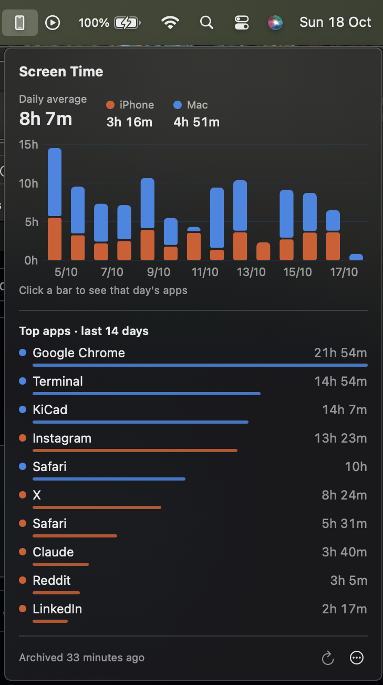

# Screen Time Archive

**Keep your iPhone and Mac Screen Time history forever, and see it from your menu bar.**

Apple only keeps about four weeks of Screen Time data. Screen Time Archive copies it from your Mac
into a local SQLite database every day, so your history keeps growing. It also adds a small menu bar
app that shows the last two weeks.

<p align="center">
  
</p>

- **iPhone + Mac.** Your iPhone's usage reaches your Mac through Screen Time's *Share Across
  Devices*. Both devices are archived, broken down by hour and by app.
- **Permanent and duplicate-free.** Every run only adds what's new, so you can run it as often as
  you like.
- **Menu bar view.** A stacked daily chart (iPhone orange, Mac blue). Click a day to see that day's
  apps.
- **Your data stays on your Mac.** No network access, no accounts, no analytics. The archive is a
  plain SQLite file you can query yourself.
- **Small.** Two Swift programs with no dependencies, about 1,400 lines in total.

## Requirements

- macOS 14 Sonoma or later (developed and tested on macOS 15.7)
- Screen Time turned on, with **Share Across Devices** enabled on both the iPhone and the Mac
  (*Settings › Screen Time* on iPhone, *System Settings › Screen Time* on Mac)
- Xcode or the Command Line Tools (`xcode-select --install`) to build

## Install

```sh
git clone https://github.com/tobias-x/screentime-archive.git
cd screentime-archive
./install.sh
```

This builds both programs, installs them, and registers two launchd agents: the archiver runs daily
at 12:30 and at login, and the menu bar app starts at login.

Then give the **archiver** Full Disk Access, which it needs to read Apple's Screen Time files:

1. Open *System Settings › Privacy & Security › Full Disk Access* and click **+**
2. Press <kbd>⌘</kbd><kbd>⇧</kbd><kbd>G</kbd> and paste
   `~/Library/Application Support/ScreenTimeArchive/bin/screentime-archiver`
3. Click ↻ in the menu bar app (or run `launchctl kickstart gui/$(id -u)/io.github.tobias-x.screentime-archiver`)

The menu bar app does **not** need Full Disk Access. It only reads your own archive, and its ↻ button
asks launchd to run the archiver.

To remove everything: `./uninstall.sh` (your archive is kept), or `./uninstall.sh --delete-archive`.

> [!NOTE]
> The binaries are ad-hoc signed, and macOS ties Full Disk Access to the exact build. **After
> rebuilding or reinstalling, remove the archiver from Full Disk Access and add it again.** The menu
> bar app shows a warning when the last run failed for this reason.

## Your archive

Everything lives in `~/Library/Application Support/ScreenTimeArchive/archive.sqlite`.
Timestamps are Unix seconds.

| Table | Contents |
|---|---|
| `sessions` | Every app session: `device_id, bundle_id, start_ts, end_ts`. This is the source of truth. |
| `hourly_usage` | Seconds per app per local hour: `device_id, bundle_id, hour_start, local_date, local_hour, seconds` |
| `devices` | `device_id, name, platform (ios / macos), os_build, …`. You can edit `name`; it's never overwritten. |
| `app_names` | Optional display-name overrides for the menu bar app |
| `runs` | One row per source per run, with status and errors |

```sql
-- iPhone hours per day
SELECT local_date, ROUND(SUM(seconds) / 3600.0, 2) AS hours
FROM hourly_usage JOIN devices USING (device_id)
WHERE platform = 'ios'
GROUP BY local_date ORDER BY local_date DESC;

-- Name an app that shows up as a bundle id
INSERT OR REPLACE INTO app_names VALUES ('com.example.SomeApp', 'Some App');
```

Command line:

```sh
screentime-archiver             # archive new data (what launchd runs)
screentime-archiver --status    # what's in the archive
screentime-archiver --diagnose  # what Apple data is visible (counts only, no app names)
```

## How it works

Apple doesn't document where Screen Time data is stored, and it has moved between macOS releases.
On macOS 15:

| Data | Location | Format |
|---|---|---|
| Other devices (iPhone) | `~/Library/Biome/streams/restricted/App.InFocus/remote/<device>/` | Biome **SEGB v2** segment files holding protobuf start/end events |
| Device metadata | `~/Library/Biome/sync/sync.db`, table `DevicePeer` | SQLite |
| This Mac | `~/Library/Application Support/Knowledge/knowledgeC.db`, `ZOBJECT` where `ZSTREAMNAME = '/app/usage'` | SQLite |
| Other devices, older macOS | `knowledgeC.db` rows whose `ZSOURCE.ZDEVICEID` is set, with `ZSYNCPEER` | SQLite (fallback, used only when Biome has no remote devices) |

Apple timestamps count seconds from 2001-01-01 UTC (add 978307200 for Unix time).

The archiver never reads Apple's files in place. It copies the SQLite databases with SQLite's online
backup API, which gives a consistent snapshot including the write-ahead log, and copies the Biome
segment files before parsing them. Start/end events are paired into sessions and inserted with
`INSERT OR IGNORE` on `(device, app, start time)`. Only the hourly buckets touched by new sessions
are recomputed.

<details>
<summary>SEGB v2 / App.InFocus format notes</summary>

- **Header (32 bytes):** `"SEGB"`, `u32` entry count, `f64` creation time, 16 bytes reserved.
- **Records** start at offset 32, 4-byte aligned. Each is a `u32` CRC32 of the payload, a `u32` flag,
  then the payload.
- **Entry table** grows backwards from the end of the file, 16 bytes per entry: `u32` end offset
  (relative to byte 32), `u32` state (1 live, 3 deleted and zeroed, 4 segment closed), `f64` timestamp.
- **Segment files** are named by creation time in microseconds since 2001. `tombstone/` holds
  deletion records and is ignored.
- **App.InFocus protobuf fields:**
  - 2: kind (1 app; 3 system overlay such as Control Center, excluded as Screen Time does)
  - 3: starting (1) or ending (0)
  - 4: timestamp (`f64`, Apple epoch)
  - 6: bundle id
  - 9, 10: app version
- **SEGB v1** (older systems) puts `"SEGB"` at offset 52. It is detected but not parsed yet.

</details>

## Troubleshooting

| Symptom | Fix |
|---|---|
| "Last run had errors" in the menu bar, or `Operation not permitted` in the log | Full Disk Access is missing or was invalidated by a rebuild. Re-add the archiver (see above). |
| No iPhone | Check that *Share Across Devices* is on for both devices and that they use the same Apple Account. Opening System Settings › Screen Time on the Mac can prompt a sync. Then run `--diagnose`. |
| Today's iPhone bar is low or empty | The iPhone syncs to the Mac every few hours, and the archiver runs daily. Click ↻ for a fresh run. |
| An app shows a bundle-ish name | Add it to `app_names` (see above), or send a PR adding it to `Sources/MenuBar/AppNames.swift`. |
| Build fails with `redefinition of module 'SwiftBridging'` | This is a known Command Line Tools packaging bug. `build.sh` works around it automatically; if you call `swiftc` yourself, see the overlay in `build.sh`. |

Logs: `~/Library/Logs/ScreenTimeArchive/archiver.log`

## Development

```
Sources/Archiver/   screentime-archiver (command line tool)
  main.swift          argument parsing, archive run, --diagnose
  Sources.swift       Biome and knowledgeC readers
  SEGB.swift          SEGB segment + protobuf decoding
  ArchiveStore.swift  archive schema, inserts, hourly buckets
  SQLite.swift        SQLite wrapper and snapshot copy
Sources/MenuBar/    ScreenTimeBar.app (SwiftUI MenuBarExtra + Swift Charts)
tests/              integration tests against synthetic Apple-format fixtures
```

```sh
./build.sh          # build into ./build (ARCH=x86_64 ./build.sh for Intel)
tests/run.sh        # integration tests, no real data or permissions needed
```

The tests generate fake SEGB, `sync.db` and `knowledgeC.db` files and check pairing, filtering,
hour splitting, deduplication, the older-macOS fallback and SEGB v1 handling. CI runs them on
macOS 14 and 15.

**Help wanted:** if it doesn't work on your macOS version, please open an issue with the output of
`--diagnose`. It prints only counts and file formats, so it's safe to share. Support for SEGB v1
(older macOS versions) would be a welcome contribution.

## Disclaimer

This project is not affiliated with or endorsed by Apple. It reads undocumented internal files that
can change with any macOS update. It only ever reads Apple's data and never modifies it.

## License

[MIT](LICENSE)
